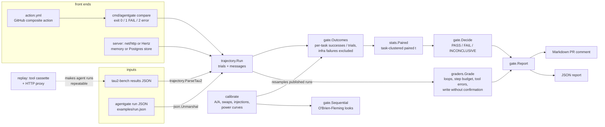

# Architecture

How the packages fit together. The statistics are in [`METHOD.md`](METHOD.md).

## Packages

| package | role |
|---|---|
| `trajectory` | data model (`Run`, `Trial`, `Message`) and the tau2-bench loader; marks infrastructure failures |
| `stats` | paired task-clustered comparison, naive baseline, pass^k, MDE, sequential bounds, kappa; JSON encodes undefined values as `null` |
| `gate` | per-task outcomes, the decision rule, `Compare` (report with per-suite results, pass^k, regressed tasks and the rules new in their failures), the sequential gate, Markdown |
| `graders` | deterministic trajectory rules used to explain a regression, not to decide it |
| `calibrate` | measures the gate on published tau2-bench trials; deterministic for a seed and independent of the data directory |
| `server` | transport-neutral core (`Server.PutRun`, `Compare`, ...) with two HTTP front ends and two stores |
| `replay` | record / replay / replay-or-record of tool calls, and an HTTP proxy in front of a tool server |
| `cmd/agentgate` | CLI: `compare`, `calibrate`, `serve`, `replay` |

## Request flow (service)

1. `PUT /v1/runs/{name}?format=tau2|run` parses the upload into a `trajectory.Run` and stores it.
2. `POST /v1/compare {"base","candidate",...}` loads both runs, runs `gate.Compare`, stores the report and
   returns it with the Markdown comment.
3. `GET /v1/reports/{id}[/comment]` reads a stored report back.

The CLI runs steps 1 and 2 in one process on two files; the GitHub action runs the CLI.
